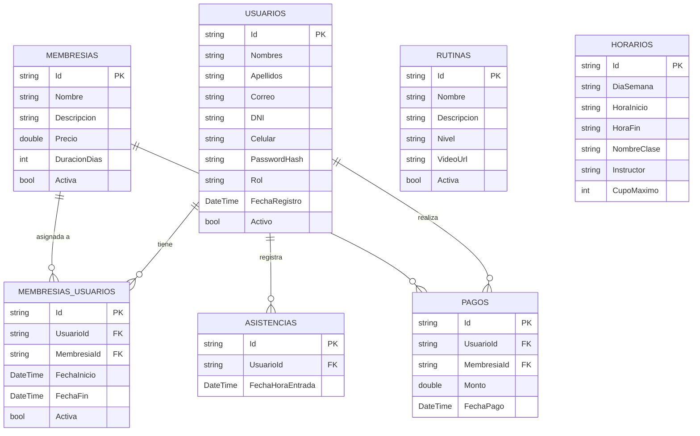
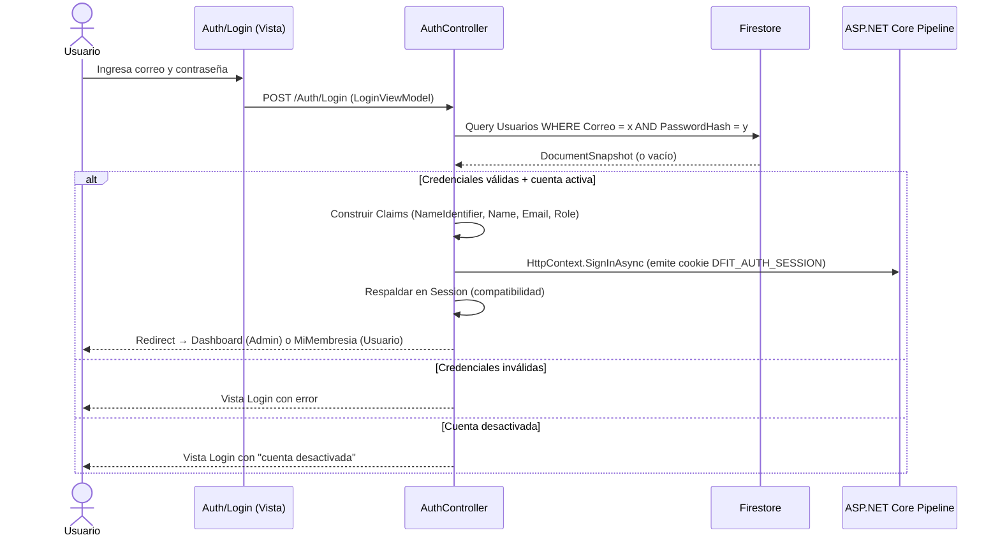
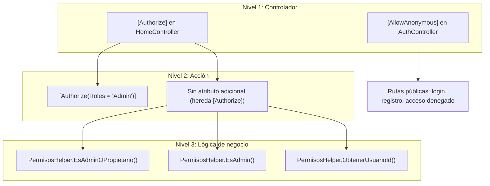
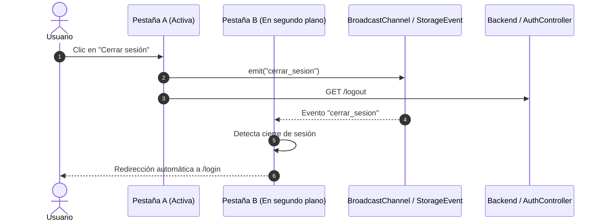
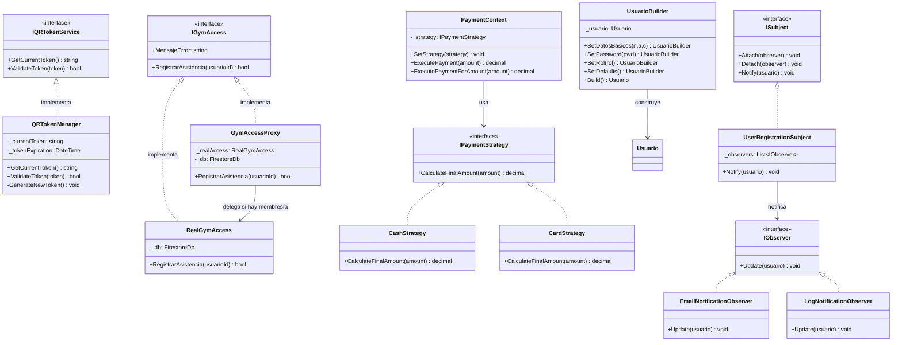
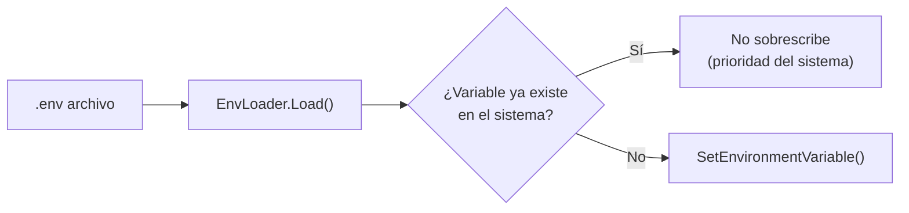
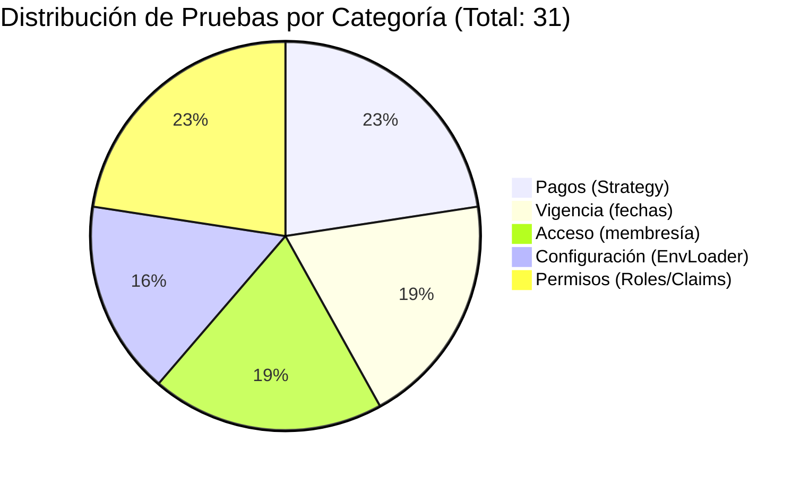
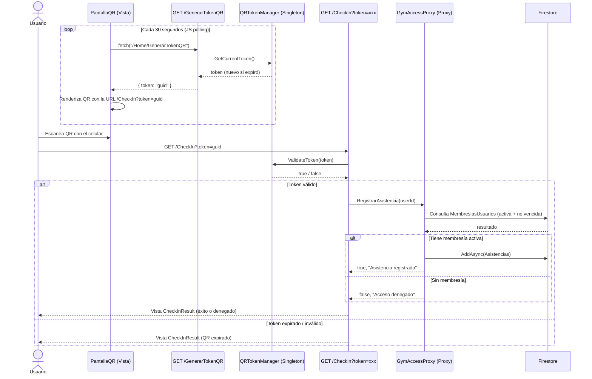
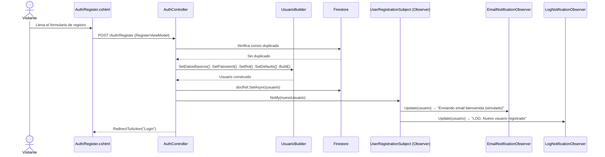

# 🏋️ Análisis Técnico Completo — DFIT Power

> Sistema de gestión para gimnasios. Web App construida con ASP.NET Core MVC + Google Firestore.

---

## 1. Stack Tecnológico y Frameworks

| Capa | Tecnología | Versión |
|---|---|---|
| **Lenguaje** | C# | .NET 10.0 |
| **Framework Web** | ASP.NET Core MVC | 10.0 |
| **Base de Datos** | Google Cloud Firestore | SDK 4.3.0 |
| **SDK Firebase** | FirebaseAdmin | 3.5.0 |
| **ORM (legado)** | Entity Framework Core SqlServer | 8.0.0 (paquete presente pero NO usado activamente — migrado a Firestore) |
| **Frontend** | Razor Views (.cshtml) + Bootstrap 5 + jQuery + Sincronización multi-pestaña (`BroadcastChannel`) | — |
| **Estilos** | CSS propio (`site.css`) + `dfit-login.css` (autenticación y accesibilidad) + Bootstrap 5 | — |
| **Contenedorización** | Docker (imagen `dotnet/aspnet:10.0`) | — |
| **Autenticación** | ASP.NET Core Cookie Authentication (`DFIT_AUTH_SESSION`) + Claims + Sincronización multi-pestaña | — |
| **Autenticación QR** | Sistema propio con tokens GUID + expiración 1 min | — |
| **Pruebas Unitarias** | MSTest v4 (SDK `MSTest.Sdk/4.0.2`) — 31 tests (100% aprobados) | 4.0.2 |

> [!NOTE]
> Tanto el `.csproj` como el `Dockerfile` apuntan a `.NET 10.0` (`net10.0`), asegurando compatibilidad completa en compilación y tiempo de ejecución.

> [!NOTE]
> EF Core SqlServer aparece en el `.csproj` como dependencia residual de una migración anterior a Firestore. No se usa en el código activo — la línea `AddDbContext` está comentada en `Program.cs`.

---

## 2. Estructura de Carpetas

```
Dfit/                               ← Raíz de la solución
├── Dfit.sln                        ← Solución con 2 proyectos (App + Tests)
├── .env.example                    ← Plantilla de variables de entorno
├── .gitignore
│
├── Dfit/                           ← Proyecto principal (Web App ASP.NET Core)
│   ├── Controllers/
│   │   ├── AuthController.cs       ← 🆕 Controlador de autenticación (300 líneas, SRP, [AllowAnonymous])
│   │   └── HomeController.cs       ← Controlador principal de negocio (826 líneas, [Authorize], RBAC)
│   │
│   ├── Models/
│   │   ├── Asistencia.cs
│   │   ├── EditUserViewModel.cs
│   │   ├── ErrorViewModel.cs
│   │   ├── Horario.cs
│   │   ├── LoginViewModel.cs
│   │   ├── Membresia.cs
│   │   ├── MembresiaUsuario.cs
│   │   ├── Pago.cs
│   │   ├── ProfileViewModel.cs
│   │   ├── RegisterViewModel.cs
│   │   ├── ReglasMembresia.cs      ← 🆕 Reglas de vigencia y acceso (funciones puras, testables)
│   │   ├── Rutina.cs
│   │   ├── Usuario.cs
│   │   └── Patterns/
│   │       ├── Builder/
│   │       │   └── UsuarioBuilder.cs
│   │       ├── Observer/
│   │       │   └── UserRegistrationObserver.cs
│   │       ├── Proxy/
│   │       │   └── GymAccessProxy.cs
│   │       ├── Singleton/
│   │       │   └── QRTokenManager.cs
│   │       └── Strategy/
│   │           └── PaymentStrategy.cs
│   │
│   ├── Utils/                       ← 🆕 Utilidades transversales
│   │   ├── EnvLoader.cs             ← Carga de variables .env (no sobrescribe las del sistema)
│   │   ├── FirebaseConfig.cs        ← Configuración Firebase (2 opciones: env vars o archivo local)
│   │   └── PermisosHelper.cs        ← Extensiones de ClaimsPrincipal para roles y permisos
│   │
│   ├── Views/
│   │   ├── Auth/                    ← 🆕 Vistas de autenticación rediseñadas
│   │   │   ├── Login.cshtml         ← Login moderno con drawer de soporte y remember email
│   │   │   ├── Register.cshtml      ← Registro con validaciones en tiempo real
│   │   │   └── AccessDenied.cshtml  ← 🆕 Página 403 de acceso denegado
│   │   ├── Home/                    ← 23 vistas Razor de negocio
│   │   │   ├── Dashboard.cshtml
│   │   │   ├── Profile.cshtml
│   │   │   ├── CreateUser.cshtml / EditUser.cshtml
│   │   │   ├── Membresias.cshtml / CreateMembresia.cshtml / EditMembresia.cshtml
│   │   │   ├── AssignMembresia.cshtml / MiMembresia.cshtml
│   │   │   ├── RegistrarPago.cshtml / PagosUsuario.cshtml / ReporteFinanciero.cshtml
│   │   │   ├── Asistencia.cshtml / CheckInResult.cshtml / PantallaQR.cshtml
│   │   │   ├── Rutinas.cshtml / CreateRutina.cshtml / EditRutina.cshtml
│   │   │   └── Horarios.cshtml / CreateHorario.cshtml / EditHorario.cshtml
│   │   └── Shared/
│   │       ├── _Layout.cshtml       ← Menú reactivo por rol, data-usuario-id y logout sync
│   │       ├── _Layout.cshtml.css
│   │       ├── _AssistanceDrawer.cshtml ← 🆕 Drawer lateral offcanvas de soporte y accesibilidad
│   │       ├── _ValidationScriptsPartial.cshtml
│   │       └── Error.cshtml
│   │
│   ├── wwwroot/
│   │   ├── css/
│   │   │   ├── site.css             ← Estilos globales de la plataforma
│   │   │   └── dfit-login.css       ← 🆕 Estilos modernos para login, registro y drawer
│   │   ├── images/logo.png
│   │   ├── js/
│   │   │   ├── site.js
│   │   │   └── dfit-sincronizacion-sesion.js ← 🆕 Sincronización multi-pestaña (BroadcastChannel)
│   │   └── lib/                     ← Bootstrap 5 + jQuery
│   │
│   ├── Program.cs                   ← Entry point, Kestrel dinámico, DI, Auth Cookies, Firebase
│   ├── Dfit.csproj
│   ├── appsettings.json
│   ├── firebase-key.json            ← ⚠️ Credenciales Firebase (en repo)
│   └── Dockerfile
│
├── PruebasUnitarias/                ← 🆕 Proyecto de pruebas unitarias (MSTest v4)
│   ├── PruebasUnitarias.csproj      ← MSTest SDK 4.0.2, referencia a Dfit.csproj
│   ├── MSTestSettings.cs            ← Configuración: ejecución paralela a nivel método
│   ├── PruebaDocumentada.cs         ← Clase base con helper Comprobar<T> (logging TRX)
│   ├── Test1.cs                     ← 7 tests: PaymentContext (Strategy y umbrales)
│   ├── CalculoVigenciaTests.cs      ← 6 tests: cálculo de fechas de vigencia
│   ├── MembresiaAccesoTests.cs      ← 6 tests: reglas de acceso por membresía
│   ├── EnvLoaderTests.cs            ← 5 tests: carga de archivos .env ([DoNotParallelize])
│   └── PermisosHelperTests.cs       ← 7 tests: validación de roles, propiedad y claims
│
├── docs/pruebas-unitarias/          ← 🆕 Documentación formal de pruebas y evidencias
│   ├── IEEE829-CASOS.md             ← Especificación de casos de prueba según norma IEEE 829
│   ├── GUIA_DEMOSTRACION.md         ← Guía paso a paso para demostración de pruebas
│   ├── README.md                    ← Informe de ejecución y resultados
│   ├── Ejecutar-Evidencia.ps1       ← Script PowerShell para generar evidencias TRX
│   └── evidencias/                  ← Reportes TRX de ciclo TDD (baseline, red, green, refactor)
│
└── Dfit_App_Movile/                 ← 📱 Aplicación móvil complementaria (Flutter)
    └── dfit_gym_app/                ← Proyecto Flutter para iOS / Android / Desktop
```

> [!CAUTION]
> El archivo `firebase-key.json` está dentro del repositorio y se copia al contenedor Docker. Esto es una **vulnerabilidad de seguridad grave** — las credenciales de Firebase nunca deben estar en el código fuente. Se recomienda usar variables de entorno o Secret Manager.

---

## 3. Modelo de Datos (Colecciones Firestore)

El proyecto NO usa una base de datos relacional. Todas las entidades son **colecciones de documentos en Firestore** (NoSQL).

### 3.1 Diagrama de Entidades



> [!NOTE]
> Al ser Firestore (NoSQL), las relaciones entre colecciones se manejan mediante IDs referenciados manualmente (no hay foreign keys reales). Los datos relacionados se obtienen con múltiples lecturas adicionales en el controlador.

### 3.2 Resumen de Colecciones

| Colección | Propósito | Campos clave |
|---|---|---|
| `Usuarios` | Miembros y admins del gym | Correo, Rol, Activo, PasswordHash |
| `Membresias` | Planes disponibles (mensual, trimestral, etc.) | Precio, DuracionDias, Activa |
| `MembresiasUsuarios` | Asignación de plan a un usuario | FechaFin, Activa (pivot) |
| `Pagos` | Registro de pagos realizados | Monto, FechaPago |
| `Asistencias` | Check-in de entrada al gym | FechaHoraEntrada |
| `Rutinas` | Planes de entrenamiento con video | Nivel, VideoUrl |
| `Horarios` | Clases grupales semanales | DiaSemana, HoraInicio, Instructor |

---

## 4. Endpoints / Rutas de la Aplicación

### 4.1 Autenticación (AuthController) 🆕

Ruta por defecto: `{controller=Auth}/{action=Login}/{id?}`

| Método | Ruta | Acceso | Descripción |
|---|---|---|---|
| GET | `/login` · `/Auth/Login` | 🌐 Anónimo | Formulario de inicio de sesión |
| POST | `/login` · `/Auth/Login` | 🌐 Anónimo | Autenticar usuario → emite cookie `DFIT_AUTH_SESSION` con Claims |
| GET | `/logout` · `/Auth/Logout` | 🔒 Autenticado | Cierre de sesión (destruye cookie + session) |
| GET | `/registro` · `/Auth/Register` | 🌐 Anónimo | Formulario de registro |
| POST | `/registro` · `/Auth/Register` | 🌐 Anónimo | Crear nuevo usuario (usa Builder + Observer) |
| GET | `/access-denied` · `/Auth/AccessDenied` | 🌐 Anónimo | Página de acceso denegado |

> [!NOTE]
> `HomeController` conserva redirecciones de compatibilidad (`/Home/Login` → `/Auth/Login`, etc.) para que las URLs antiguas sigan funcionando.

### 4.2 Gestión de Usuarios (Admin)

| Método | Ruta | Acceso | Descripción |
|---|---|---|---|
| GET | `/Home/Dashboard` | 🔴 Admin | Lista de todos los usuarios + filtro de búsqueda |
| GET | `/Home/CreateUser` | 🔴 Admin | Formulario crear usuario |
| POST | `/Home/CreateUser` | 🔴 Admin | Guardar nuevo usuario |
| GET | `/Home/EditUser/{id}` | 🔴 Admin | Formulario editar usuario |
| POST | `/Home/EditUser` | 🔴 Admin | Actualizar datos de usuario |
| POST | `/Home/DeleteUser` | 🔴 Admin | Eliminar usuario de Firestore |
| POST | `/Home/ToggleUserStatus` | 🔴 Admin | Activar/Desactivar cuenta de usuario |
| GET | `/Home/Profile/{id}` | 🔒 Admin o Propietario | Ver perfil de usuario |
| POST | `/Home/Profile` | 🔒 Admin o Propietario | Actualizar nombre, correo y/o contraseña |

### 4.3 Membresías

| Método | Ruta | Acceso | Descripción |
|---|---|---|---|
| GET | `/Home/Membresias` | 🔴 Admin | Lista de planes de membresía |
| GET | `/Home/CreateMembresia` | 🔴 Admin | Formulario nueva membresía |
| POST | `/Home/CreateMembresia` | 🔴 Admin | Guardar nueva membresía |
| GET | `/Home/EditMembresia/{id}` | 🔴 Admin | Formulario editar membresía |
| POST | `/Home/EditMembresia` | 🔴 Admin | Actualizar membresía |
| POST | `/Home/DeleteMembresia` | 🔴 Admin | Eliminar membresía |
| GET | `/Home/AssignMembresia?usuarioId={id}` | 🔴 Admin | Seleccionar plan para asignar a usuario |
| POST | `/Home/AssignMembresia` | 🔴 Admin | Crear registro `MembresiasUsuarios` (usa `ReglasMembresia.CalcularFechaFin`) |
| GET | `/Home/MiMembresia/{id}` | 🔒 Admin o Propietario | Ver membresía activa del usuario |
| POST | `/Home/CancelMembresia` | 🔒 Admin o Propietario | Usuario cancela su membresía |
| POST | `/Home/AdminRemoveMembresia` | 🔴 Admin | Admin remueve membresía de usuario |

### 4.4 Recepción, Pagos y Control de Vigencia 🆕

| Método | Ruta | Acceso | Descripción |
|---|---|---|---|
| GET | `/Home/Recepcion` | 🟡 Admin o Recepcionista | **Ventana de Recepción:** monitor de vigencias, búsqueda ágil de socios, cobro rápido y KPI de caja del día |
| POST | `/Home/RegistrarSocioRecepcion` | 🟡 Admin o Recepcionista | Registrar nuevo socio ágilmente con opción de cobro y activación de plan inmediato |
| GET | `/Home/RegistrarPago?usuarioId={id}` | 🟡 Admin o Recepcionista | Formulario de pago con previsualización de cálculo de vigencia |
| POST | `/Home/RegistrarPago` | 🟡 Admin o Recepcionista | **Adecuación/Corrección Funcional:** procesa el pago (Strategy) y **actualiza de inmediato la membresía y vigencia** del socio (`ReglasMembresia.CalcularPeriodoVigencia`) |
| GET | `/Home/PagosUsuario/{id}` | 🔒 Admin, Recepcionista o Propietario | Historial de pagos de un socio |
| GET | `/Home/ReporteFinanciero` | 🔴 Admin | Reporte global: ingresos totales y del mes |

### 4.5 Control de Asistencia

| Método | Ruta | Acceso | Descripción |
|---|---|---|---|
| GET | `/Home/Asistencia` | 🟡 Admin o Recepcionista | Panel de asistencia del día actual |
| POST | `/Home/RegistrarAsistencia` | 🟡 Admin o Recepcionista | Registrar entrada manual (verifica membresía activa y vigente) |
| GET | `/Home/PantallaQR` | 🔴 Admin | Pantalla con código QR en tiempo real |
| GET | `/Home/GenerarTokenQR` | 🔴 Admin | API JSON que devuelve el token QR actual |
| GET | `/Home/CheckIn?token={token}` | 🔒 Autenticado | Validar QR y registrar asistencia (usa Proxy + Singleton) |

### 4.6 Rutinas y Horarios

| Método | Ruta | Acceso | Descripción |
|---|---|---|---|
| GET | `/Home/Rutinas` | 🔒 Autenticado | Lista de rutinas activas |
| GET | `/Home/CreateRutina` | 🔴 Admin | Formulario nueva rutina |
| POST | `/Home/CreateRutina` | 🔴 Admin | Guardar rutina |
| GET | `/Home/EditRutina/{id}` | 🔴 Admin | Formulario editar rutina |
| POST | `/Home/EditRutina` | 🔴 Admin | Actualizar rutina |
| POST | `/Home/DeleteRutina` | 🔴 Admin | Desactivar rutina (soft delete) |
| GET | `/Home/Horarios` | 🔒 Autenticado | Lista de horarios semanales |
| GET | `/Home/CreateHorario` | 🔴 Admin | Formulario nuevo horario |
| POST | `/Home/CreateHorario` | 🔴 Admin | Guardar horario |
| GET | `/Home/EditHorario/{id}` | 🔴 Admin | Formulario editar horario |
| POST | `/Home/EditHorario` | 🔴 Admin | Actualizar horario |
| POST | `/Home/DeleteHorario` | 🔴 Admin | Eliminar horario |

**Leyenda de acceso:**
- 🌐 Anónimo — No requiere autenticación
- 🔒 Autenticado — Requiere cookie de sesión válida (`[Authorize]`)
- 🔒 Admin, Recepcionista o Propietario — Autenticado + validación con `PermisosHelper.EsAdminOPropietario()`
- 🟡 Admin o Recepcionista — Requiere rol `Admin` o `Recepcionista` (`[Authorize(Roles = "Admin,Recepcionista")]`)
- 🔴 Admin — Requiere rol `Admin` (`[Authorize(Roles = "Admin")]`)

---

## 5. Sistema de Autenticación y Control de Acceso 🆕

### 5.1 Flujo de Autenticación (Cookie-based)



### 5.2 Configuración de Autenticación (Program.cs)

```csharp
builder.Services.AddAuthentication(CookieAuthenticationDefaults.AuthenticationScheme)
    .AddCookie(options =>
    {
        options.LoginPath = "/login";
        options.LogoutPath = "/logout";
        options.AccessDeniedPath = "/Auth/AccessDenied";
        options.Cookie.Name = "DFIT_AUTH_SESSION";
        options.Cookie.HttpOnly = true;
        options.Cookie.SameSite = SameSiteMode.Lax;
        options.ExpireTimeSpan = TimeSpan.FromHours(8);
        options.SlidingExpiration = true;
    });
```

### 5.3 Control de Acceso por Niveles



| Nivel | Mecanismo | Dónde se aplica |
|---|---|---|
| **Controlador** | `[Authorize]` en `HomeController` | Todas las acciones requieren autenticación por defecto |
| **Acción** | `[Authorize(Roles = "Admin")]` | Dashboard, CRUD usuarios, membresías, pagos, rutinas, horarios |
| **Lógica** | `User.EsAdminOPropietario(id)` | Profile, MiMembresia, PagosUsuario, CancelMembresia |
| **Anónimo** | `[AllowAnonymous]` | Login, Register, AccessDenied, redirecciones de compatibilidad |

### 5.4 PermisosHelper — Extensiones de ClaimsPrincipal

| Método | Firma | Comportamiento |
|---|---|---|
| `EsAdmin()` | `ClaimsPrincipal?.EsAdmin() → bool` | Verifica si el claim `Role` es `"Admin"` |
| `ObtenerUsuarioId()` | `ClaimsPrincipal?.ObtenerUsuarioId() → string?` | Extrae el claim `NameIdentifier` |
| `EsAdminOPropietario()` | `ClaimsPrincipal?.EsAdminOPropietario(targetId) → bool` | `true` si es Admin **o** si su ID coincide con el `targetId` |

### 5.5 Sincronización de Sesión Multi-Pestaña (`dfit-sincronizacion-sesion.js`) 🆕

DFIT implementa una arquitectura de comunicación entre pestañas (*cross-tab state sync*) para resolver el problema clásico de desincronización de sesión:



| Componente | Mecanismo | Propósito |
|---|---|---|
| **Canal Principal** | `BroadcastChannel("dfit_canal_autenticacion")` | Comunicación bidireccional y de baja latencia entre pestañas |
| **Fallback Universal** | `window.addEventListener("storage")` | Respaldo para navegadores o entornos donde `BroadcastChannel` esté restringido |
| **Identidad en DOM** | `<body data-usuario-id="...">` en `_Layout.cshtml` | Permite a cada vista comparar el usuario que dibujó el HTML contra la cookie activa |
| **Detección en Reactivación** | `document.addEventListener("visibilitychange")` | Al traer al frente una pestaña en segundo plano, valida si la sesión cambió o caducó |
| **Intercambio de Cuenta** | Evento `cambio_cuenta` | Si el usuario inicia sesión con otra cuenta en la pestaña B, la pestaña A se actualiza sin pantalla de error |

### 5.6 Canales de Asistencia y Accesibilidad (`_AssistanceDrawer.cshtml`) 🆕

Diseñado como un drawer lateral offcanvas reutilizable (`#assistanceDrawer`), accesible desde Login, Register y vistas públicas:

- **Canales de Atención Directa**: Enlaces rápidos a WhatsApp de administración con mensaje precargado, correo corporativo (`soporte@dfitpower.com`) y central telefónica.
- **Recordar Correo Electrónico**: Checkbox interactivo que persiste el correo en `localStorage` (`dfit_saved_email`) para agilizar logins recurrentes.
- **Limpieza Rápida de Entradas**: Botón integrado (`btn-clear-input`) para vaciar los campos de formulario de forma accesible.
- **Compatibilidad con Lectores de Pantalla**: Alertas con atributos `role="alert"` y `aria-live="assertive"` para feedback inmediato de errores de validación.
- **Hoja de Estilos Dedicada**: `dfit-login.css` desacopla los estilos de autenticación y soporte de `site.css`, garantizando diseño responsivo y sin desbordamientos verticales.

---

## 6. Patrones de Diseño Implementados



### Resumen de Patrones

| Patrón | Clase | Propósito en DFIT |
|---|---|---|
| **Singleton** | `QRTokenManager` | Un único token QR activo para toda la app, se regenera cada 60 segundos |
| **Proxy** | `GymAccessProxy` → `RealGymAccess` | Intercepta el registro de asistencia y verifica membresía activa antes de permitir el acceso |
| **Strategy** | `CashStrategy` / `CardStrategy` + `PaymentContext` | Permite cambiar la lógica de cálculo de pago (efectivo sin recargo, tarjeta +5%) en tiempo de ejecución. `ExecutePaymentForAmount` selecciona automáticamente la estrategia según el monto |
| **Observer** | `UserRegistrationSubject` → `EmailNotificationObserver` + `LogNotificationObserver` | Al registrar un usuario, notifica automáticamente a múltiples sistemas (simulado: email y log) |
| **Builder** | `UsuarioBuilder` | Construye un objeto `Usuario` de forma fluida y legible, evitando constructores con muchos parámetros |

---

## 7. Utilidades Transversales (Capa Utils) 🆕

### 7.1 EnvLoader — Carga de Variables de Entorno



| Característica | Detalle |
|---|---|
| **Búsqueda jerárquica** | ContentRoot → padre → abuelo → CWD → BaseDirectory |
| **Formatos soportados** | Valores simples, con comillas (`"..."`), multilínea, comentarios `#` |
| **No sobrescribe** | Si la variable ya existe en el sistema (Render, Docker), no la reemplaza |
| **Uso** | `EnvLoader.Load(contentRootPath)` en `Program.cs` al arrancar |

### 7.2 FirebaseConfig — Configuración Dual de Credenciales

| Opción | Fuente | Ideal para |
|---|---|---|
| **A** | `FIREBASE_CLIENT_EMAIL` + `FIREBASE_PRIVATE_KEY` | Render, Cloud, producción |
| **B** | `FIREBASE_KEY_PATH` o `firebase-key.json` local | Desarrollo local |

Si ninguna opción produce credenciales válidas, lanza `InvalidOperationException` con instrucciones claras.

### 7.3 ReglasMembresia — Reglas de Negocio Puras

```csharp
public static class ReglasMembresia
{
    public static DateTime CalcularFechaFin(DateTime fechaInicio, int duracionDias)
        => fechaInicio.AddDays(duracionDias);

    public static bool PermiteAcceso(bool activa, DateTime fechaFin, DateTime ahora)
        => activa && fechaFin > ahora;
}
```

> [!TIP]
> `ReglasMembresia` está diseñado como **funciones puras** — no depende del reloj del sistema (`DateTime.Now`) sino que recibe el instante como parámetro, lo que permite testear todos los casos borde sin mockear el tiempo.

---

## 8. Pruebas Unitarias 🆕

### 8.1 Arquitectura del Proyecto de Tests

| Componente | Descripción |
|---|---|
| **Framework** | MSTest v4 (SDK `MSTest.Sdk/4.0.2`) |
| **Target** | `net10.0` (mismo que el proyecto principal) |
| **Referencia** | `ProjectReference` a `Dfit.csproj` |
| **Paralelismo** | Habilitado a nivel de método (`ExecutionScope.MethodLevel`) |
| **Clase base** | `PruebaDocumentada` — helper `Comprobar<T>()` que loguea esperado/obtenido en el informe TRX |

### 8.2 Inventario de Pruebas (31 tests)



#### PaymentContextTests (7 tests) — Categoría: `Pagos`

| ID | Caso de prueba | Qué valida |
|---|---|---|
| CP-PAG-001 | Pago con tarjeta 200 → 210 | Aplica +5% de recargo |
| CP-PAG-002 | Pago en efectivo 100 → 100 | Sin recargo |
| CP-PAG-003 | Sin estrategia definida → 200 | Fallback a efectivo |
| CP-PAG-004 | `ExecutePaymentForAmount` < 100 | Auto-selecciona efectivo |
| CP-PAG-005 | `ExecutePaymentForAmount` = 100 | Borde: efectivo |
| CP-PAG-006 | `ExecutePaymentForAmount` > 100 | Auto-selecciona tarjeta |
| CP-PAG-007 | Pagos consecutivos reevalúan | Estrategia cambia dinámicamente |

#### CalculoVigenciaTests (6 tests) — Categoría: `Vigencia`

| ID | Caso de prueba | Qué valida |
|---|---|---|
| CP-VIG-001 | Membresía mensual (30 días) | Suma exactamente 30 días |
| CP-VIG-002 | Membresía anual (365 días) | 1 ene 2026 → 1 ene 2027 |
| CP-VIG-003 | Membresía trimestral (90 días) | Suma correcta |
| CP-VIG-004 | Inicio fin de mes (31 ene) | No usa mes calendario, sino días |
| CP-VIG-005 | Año bisiesto (28 feb 2028 + 1) | Incluye 29 de febrero |
| CP-VIG-006 | Cambio de año (31 dic + 1) | Conserva hora original |

#### MembresiaAccesoTests (6 tests) — Categoría: `Acceso`

| ID | Caso de prueba | Qué valida |
|---|---|---|
| CP-ACC-001 | Activa + vigente | ✅ Permite acceso |
| CP-ACC-002 | Activa + vencida | ❌ Deniega |
| CP-ACC-003 | Inactiva + vigente | ❌ Deniega |
| CP-ACC-004 | Instante exacto de vencimiento | ❌ Deniega (frontera exclusiva) |
| CP-ACC-005 | Un tick antes de vencer | ✅ Permite |
| CP-ACC-006 | Un tick después de vencer | ❌ Deniega |

#### EnvLoaderTests (5 tests) — Categoría: `Configuracion`

| ID | Caso de prueba | Qué valida |
|---|---|---|
| CP-ENV-001 | Variables simples y con comillas | Parseo correcto |
| CP-ENV-002 | Variable ya existe en sistema | No sobrescribe |
| CP-ENV-003 | Valor multilínea | Conserva saltos de línea |
| CP-ENV-004 | Archivo inexistente | No crea archivo, no altera variables |
| CP-ENV-005 | Líneas inválidas / `=` dentro del valor | Ignora mal formato, conserva `=` en valores |

#### PermisosHelperTests (7 tests) — Categoría: `Permisos`

| Caso de prueba | Qué valida |
|---|---|
| Admin con rol → `EsAdmin()` = true | Reconoce rol Admin |
| Usuario sin rol Admin → false | Rechaza roles no-admin |
| Admin accediendo a recurso ajeno → true | Admin tiene acceso universal |
| Socio accediendo a su propio recurso → true | Propietario puede ver lo suyo |
| Socio accediendo a recurso ajeno → false | Bloquea acceso cruzado |
| `ClaimsPrincipal null` → false | Manejo seguro de nulos |
| `ObtenerUsuarioId()` con claim → retorna ID | Extrae claim `NameIdentifier` correctamente |

> [!NOTE]
> Los tests de `EnvLoaderTests` están marcados con `[DoNotParallelize]` porque manipulan variables de entorno, que son estado global compartido del proceso.

### 8.3 Ejecución

```bash
# Desde la raíz de la solución
dotnet test

# Con reporte TRX (aprovecha PruebaDocumentada)
dotnet test --logger "trx;LogFileName=resultados.trx"
```

### 8.4 Documentación Formal IEEE 829 y Ciclo TDD 🆕

El repositorio incorpora en `docs/pruebas-unitarias/` un marco formal de testing bajo la norma internacional **IEEE 829**:

| Documento / Recurso | Propósito y Contenido |
|---|---|
| `IEEE829-CASOS.md` | Especificación de diseño de pruebas, identificadores únicos de caso, precondiciones, entradas, salidas esperadas y matriz de trazabilidad con requerimientos. |
| `GUIA_DEMOSTRACION.md` | Procedimiento de verificación paso a paso para auditorías y demostración en vivo de las pruebas. |
| `Ejecutar-Evidencia.ps1` | Script automatizado en PowerShell que ejecuta MSTest y recopila evidencias en formato TRX, JSON y texto. |
| `evidencias/` | Registros históricos del ciclo TDD: `baseline.trx` (10 pruebas iniciales), `red.trx` (fallo provocado al aislar lógica), `green.trx` (24 pruebas aprobadas con `ReglasMembresia`) y `refactor.trx`. |

---

## 9. Diagrama de Comunicación — Flujo de Check-in por QR



---

## 10. Diagrama de Comunicación — Registro de Usuario



---

## 11. Diagrama de Arquitectura General

```mermaid
graph TB
    subgraph Cliente["🌐 Cliente (Navegador)"]
        Browser["Bootstrap 5 + Razor Views\n(.cshtml)"]
        SyncTab["Módulo de Sincronización\n(dfit-sincronizacion-sesion.js\nBroadcastChannel + Storage)"]
        Drawer["Canales de Soporte\n(_AssistanceDrawer.cshtml\nWhatsApp, Email, A11y)"]
        Browser --- SyncTab
        Browser --- Drawer
    end

    subgraph Servidor["🖥️ ASP.NET Core MVC (.NET 10)"]
        Router["Middleware Pipeline\n(Routing, StaticFiles, Kestrel,\nSession, Authentication, Authorization)"]

        subgraph Controllers["📋 Controllers"]
            AuthCtrl["AuthController\n(Login, Register, Logout,\nAccessDenied)"]
            HomeCtrl["HomeController\n(CRUD, Membresías, Pagos,\nAsistencia, Rutinas, Horarios)"]
        end

        subgraph Utils["🔧 Utils"]
            EnvLoader["EnvLoader\n(carga .env)"]
            FBConfig["FirebaseConfig\n(credenciales dual)"]
            Permisos["PermisosHelper\n(EsAdmin, EsAdminOPropietario)"]
        end

        subgraph Modelos["📊 Modelos"]
            Reglas["ReglasMembresia\n(funciones puras)"]
        end

        subgraph Patrones["📐 Design Patterns"]
            Singleton["Singleton\nQRTokenManager"]
            Proxy["Proxy\nGymAccessProxy"]
            Strategy["Strategy\nPaymentContext"]
            Observer["Observer\nUserRegistrationSubject"]
            Builder["Builder\nUsuarioBuilder"]
        end

        DI["DI Container\n(Program.cs)"]
    end

    subgraph Firebase["☁️ Google Firebase (Cloud)"]
        Firestore["Cloud Firestore\nProyecto: dfit-gym"]
        Auth["FirebaseAdmin SDK\n(Credential)"]
    end

    subgraph Testing["🧪 Pruebas Unitarias & IEEE 829"]
        MSTest["MSTest v4\n31 tests (100% OK)\n5 clases + TRX"]
        IEEE["Docs IEEE 829\n(Planes, Guía, Casos)"]
        MSTest --- IEEE
    end

    Browser -->|HTTP Request| Router
    Router --> AuthCtrl
    Router --> HomeCtrl
    AuthCtrl --> Observer
    AuthCtrl --> Builder
    HomeCtrl --> Singleton
    HomeCtrl --> Proxy
    HomeCtrl --> Strategy
    HomeCtrl --> Reglas
    HomeCtrl -.->|usa| Permisos
    DI -.--->|Inyecta| AuthCtrl
    DI -.--->|Inyecta| HomeCtrl
    DI -.--->|Inyecta| Proxy
    DI -.--->|Inyecta| Strategy
    EnvLoader -.->|carga .env| FBConfig
    FBConfig -->|inicializa| Firestore
    AuthCtrl -->|Login/Register| Firestore
    HomeCtrl -->|CRUD| Firestore
    Proxy -->|Consulta membresía| Firestore
    Auth -->|service account| Firestore
    HomeCtrl -->|Responde| Browser
    AuthCtrl -->|Responde| Browser
    MSTest -.->|testea| Strategy
    MSTest -.->|testea| Reglas
    MSTest -.->|testea| Permisos
    MSTest -.->|testea| EnvLoader
```

---

## 12. Configuración de Entorno y Requerimientos

### 12.1 Variables / Archivos de Configuración

| Archivo | Propósito |
|---|---|
| `.env.example` | 🆕 Plantilla de variables de entorno con instrucciones |
| `.env` (no commiteado) | 🆕 Variables de entorno locales (cargado por `EnvLoader`) |
| `appsettings.json` | Logging + connection string SQL (legada, no activa) |
| `appsettings.Development.json` | Overrides para desarrollo local |
| `firebase-key.json` | Credenciales del Service Account de Google/Firebase (⚠️ en repo) |

### 12.2 Variables de Entorno

| Variable | Requerida | Descripción |
|---|---|---|
| `FIREBASE_PROJECT_ID` | Opcional | ID del proyecto Firebase (default: `dfit-gym-cd550`) |
| `FIREBASE_CLIENT_EMAIL` | Opción A | Email del service account |
| `FIREBASE_PRIVATE_KEY` | Opción A | Clave RSA privada (soporta `\\n` literal) |
| `FIREBASE_KEY_PATH` | Opción B | Ruta al archivo JSON de credenciales |
| `PORT` | Opcional | Puerto de escucha (detectado por Kestrel para Render/Cloud/Docker) |
| `ASPNETCORE_ENVIRONMENT` | Opcional | `Development` (localhost) o `Production` (wildcard `http://*:{PORT}`) |

### 12.3 Requerimientos para Ejecutar Localmente

1. **.NET SDK 10.0** instalado
2. Archivo `.env` o `firebase-key.json` válido en la raíz
3. Proyecto Firebase `dfit-gym-cd550` creado con Firestore habilitado
4. Comando: `dotnet run` desde la carpeta `Dfit/`
   > Kestrel detectará automáticamente si el entorno es `Development` para bindear a `localhost:{PORT}` o wildcard `http://*:{PORT}` en `Production`.

### 12.4 Requerimientos para Docker

```bash
docker build -t dfit .
docker run -p 8080:8080 dfit
```

> [!NOTE]
> El Dockerfile y el proyecto apuntan a `.NET 10.0` (`mcr.microsoft.com/dotnet/sdk:10.0` y `mcr.microsoft.com/dotnet/aspnet:10.0`).

---

## 13. Dependencias NuGet (`.csproj`)

### Proyecto Principal (`Dfit.csproj`)

| Paquete | Versión | Uso |
|---|---|---|
| `FirebaseAdmin` | 3.5.0 | Inicialización de Firebase App, autenticación con Google Credentials |
| `Google.Cloud.Firestore` | 4.3.0 | Cliente Firestore: lectura/escritura de documentos |
| `Microsoft.EntityFrameworkCore.SqlServer` | 8.0.0 | ⚠️ Legado — no activo |
| `Microsoft.EntityFrameworkCore.Design` | 8.0.0 | ⚠️ Legado — no activo |
| `Microsoft.EntityFrameworkCore.Tools` | 8.0.0 | ⚠️ Legado — no activo |

### Proyecto de Tests (`PruebasUnitarias.csproj`)

| Paquete / SDK | Versión | Uso |
|---|---|---|
| `MSTest.Sdk` | 4.0.2 | Framework de testing (incluye MSTest.TestFramework + TestAdapter) |
| `ProjectReference: Dfit.csproj` | — | Acceso directo a modelos, utils y patrones |

### Frontend (wwwroot/lib — librerías de cliente)

- **Bootstrap 5** — Grid, componentes UI, formularios, offcanvas drawer
- **jQuery** — Manipulación DOM, AJAX requests (polling QR)
- **dfit-sincronizacion-sesion.js** — Pub/Sub cross-tab vía BroadcastChannel y Storage Events

---

## 14. Observaciones y Puntos de Mejora

| # | Observación | Severidad | Estado |
|---|---|---|---|
| 1 | `firebase-key.json` commiteado al repo — riesgo de exposición de credenciales | 🔴 Crítico | ⚠️ Mitigado parcialmente con `EnvLoader` + `FirebaseConfig` (soporte para variables de entorno), pero el archivo aún está en el repo |
| 2 | Contraseñas almacenadas en texto plano (`PasswordHash` es solo texto) — no hay hashing real | 🔴 Crítico | Pendiente |
| 3 | ~~No hay autenticación de sesión real~~ → Implementado sistema completo de Cookie Authentication con Claims, `[Authorize]`, roles, expiración de 8h y sliding expiration | ✅ Resuelto | `AuthController` + `Program.cs` |
| 4 | ~~Un solo controlador~~ → Separado en `AuthController` (300 líneas) + `HomeController` (826 líneas) | ✅ Parcialmente resuelto | `HomeController` sigue siendo grande; considerar separar en más controladores por dominio |
| 5 | EF Core + SQL Server declarado como dependencia pero sin uso — limpiar el `.csproj` | 🟡 Medio | Pendiente |
| 6 | Incompatibilidad `net10.0` vs imagen Docker `aspnet:8.0` | ✅ Resuelto | Dockerfile actualizado a `dotnet/aspnet:10.0` |
| 7 | Múltiples lecturas secuenciales a Firestore por entidad (sin batch queries ni caché) | 🟡 Medio | Pendiente |
| 8 | `GymAccessProxy` usa `.Result` en métodos async — riesgo de deadlock | 🟠 Alto | Pendiente |
| 9 | 🆕 31 pruebas unitarias implementadas cubriendo Strategy, reglas de membresía, EnvLoader y PermisosHelper (100% aprobadas) | ✅ Logro | Ejecutables con `dotnet test` |
| 10 | 🆕 Control de acceso granular con `[Authorize(Roles)]` + `PermisosHelper` en lógica de negocio | ✅ Logro | Resuelve el punto #3 original |
| 11 | 🆕 `EnvLoader` + `FirebaseConfig` permiten configuración sin archivo hardcodeado | ✅ Logro | Compatible con Render y desarrollo local |
| 12 | 🆕 Sincronización reactiva de sesión multi-pestaña (`dfit-sincronizacion-sesion.js` vía BroadcastChannel) | ✅ Logro | Elimina errores de concurrencia y desincronización entre pestañas |
| 13 | 🆕 Componente compartido de Asistencia y Accesibilidad (`_AssistanceDrawer.cshtml` + `dfit-login.css`) | ✅ Logro | Soporte WhatsApp, correo, botones de borrado y recordar usuario |
| 14 | 🆕 Documentación formal de pruebas bajo norma IEEE 829 y scripts de automatización TRX en `docs/pruebas-unitarias/` | ✅ Logro | Trazabilidad completa con ciclo TDD (Baseline, Red, Green, Refactor) |
