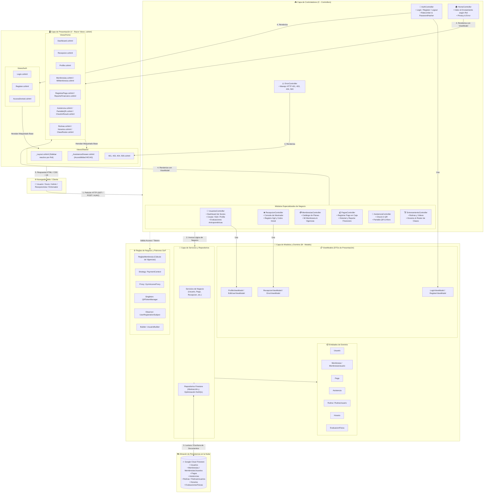

# 🏋️ Diagrama de Arquitectura MVC — DFIT Power

> [!info] Resumen del Sistema
> **DFIT Power** es una aplicación web empresarial orientada a la administración de gimnasios, membresías, asistencias biométricas/QR, rutinas y balances financieros, construida bajo el patrón arquitectónico **MVC (Modelo - Vista - Controlador)** con persistencia distribuida en la nube (**Google Cloud Firestore**).

---

## 🗺️ Mapa Arquitectónico MVC (Mermaid)

---

## 🧩 Desglose de Componentes

### 1. Controladores (`Controllers/`)
> [!note] Responsabilidad
> Atienden las peticiones HTTP, validan la autenticación y autorización basada en Roles (`Admin`, `Recepcionista`, `Entrenador`, `Usuario`), interactúan con los servicios de aplicación y seleccionan la vista adecuada.

* **`AuthController`:** Login, registro de socios, cierre de sesión, rate limiting anti-fuerza bruta e integración con PBKDF2.
* **`ErrorController`:** Renderizado amigable de errores HTTP (401 No Autorizado, 403 Acceso Denegado, 404 No Encontrado, 500 Error de Servidor).
* **`HomeController`:** Enrutamiento inicial del usuario según su rol hacia el módulo correspondiente.
* **Módulos de Negocio Refactorizados:**
  * **`UsuariosController`:** Administración de socios, perfiles y valoraciones antropométricas.
  * **`RecepcionController`:** Consola operativa ágil del recepcionista (monitoreo de vencimientos y ventas).
  * **`MembresiasController`:** Gestión del catálogo de suscripciones y portal del socio.
  * **`PagosController`:** Registro de cobros, transacciones y balance financiero mensual.
  * **`AsistenciaController`:** Registro de check-in mediante códigos QR dinámicos y control de aforo.
  * **`EntrenamientoController`:** Catálogo de rutinas con video de YouTube, horarios semanales y asistencia a clases grupales.

---

### 2. Modelos (`Models/`)
> [!tip] Responsabilidad
> Representan las estructuras de datos, las reglas de negocio puras y la interacción con la persistencia.

* **`ViewModels`:** Modelos especializados para transferir datos hacia y desde las vistas Razor (`ProfileViewModel`, `RecepcionViewModel`, `LoginViewModel`), aplicando validaciones declarativas mediante `DataAnnotations`.
* **Entidades de Dominio:** Estructuras que reflejan los documentos de Cloud Firestore (`Usuario`, `Membresia`, `Pago`, `Asistencia`, `Rutina`, `Horario`, `EvaluacionFisica`).
* **Patrones de Diseño Implementados:**
  * **Builder (`UsuarioBuilder`):** Construcción fluida de entidades `Usuario` con inyección segura de hash.
  * **Strategy (`PaymentContext`):** Estrategias de cálculo y procesamiento de pagos.
  * **Proxy (`GymAccessProxy`):** Control y validación de reglas de acceso previo a conceder ingreso.
  * **Singleton (`QRTokenManager`):** Generador de tokens QR con expiración a 60 segundos.
  * **Observer (`UserRegistrationSubject`):** Notificaciones desacopladas tras el registro de socios.
* **Capa de Repositorios:** Abstracción que elimina consultas directas de Firestore en controladores, resolviendo el problema de consultas $N+1$.

---

### 3. Vistas (`Views/`)
> [!architecture] Responsabilidad
> Renderizado del lado del servidor (*Server-Side Rendering*) mediante plantillas Razor (`.cshtml`), enriquecidas con componentes interactivos y accesibilidad adaptativa.

* **`Views/Auth/`:** Pantallas de acceso al sistema con estilos dedicados (`dfit-login.css`).
* **`Views/Home/`:** Vistas de gestión de datos, tablas reactivas, formularios y tableros de control.
* **`Views/Shared/`:**
  * **`_Layout.cshtml`:** Menú de navegación dinámico adaptado a los permisos del rol activo.
  * **`_AssistanceDrawer.cshtml`:** Panel lateral de ayuda y accesibilidad adaptativo a dispositivos móviles/táctiles y atajos de teclado (`Option + A` en Mac, `Alt + A` en Windows/Linux).
  * **`dfit-sincronizacion-sesion.js`:** Sincronización multi-pestaña mediante `BroadcastChannel`.
