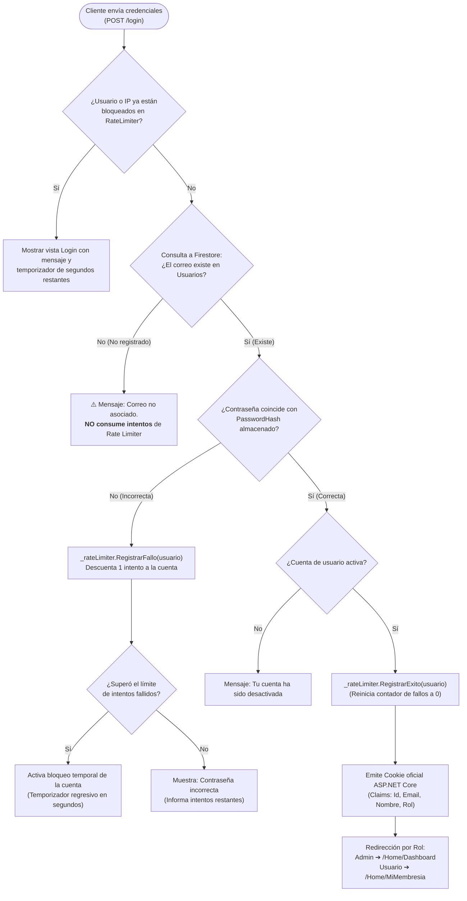

# 📋 Lista de Tareas y Control de Calidad — DFIT Power

Documento de seguimiento de tareas técnicas, seguridad, entregables académicos (T2), inclusión/accesibilidad y avance de paper sobre Calidad de Software (OD13 / CMMI).

---

## 🎓 Requerimientos y Entregables para esta Entrega

| ID | Requerimiento de Entrega | Tipo | Estado | Descripción / Criterio de Cumplimiento |
|:---:|---|:---:|:---:|---|
| **E-01** | **Documentar correcciones de observaciones T2** | Documentación / Evidencias | ⏳ **En Progreso** | Capturas de pantalla o video demostrativo de las 6 correcciones (bloqueo por usuario, política de contraseñas, trim, encapsulación de errores, hash de contraseñas y compresión). |
| **E-02** | **Informe de calidad de inclusión y accesibilidad** | Informe Técnico | 🟡 **En Progreso** | Implementado script adaptativo multiplataforma para atajo de asistencia (oculto en móviles táctiles, `Option + A` en Mac y `Alt + A` en Windows con atributos `aria-keyshortcuts`). Pendiente informe formal. |
| **E-03** | **Avance de Paper orientado a OD13 (Calidad de Software)** | Investigación Académica | ⏳ **Pendiente** | Redacción del avance del paper sustentado en el documento de referencia `paper.pdf` (*"Introducción a la Calidad de Software"*, López, Cabrera y Valencia, Scientia et Technica, 2008). Enfoque en los **5 niveles de madurez CMMI**, dimensiones de calidad de Pressman/Secades y cómo las métricas estáticas (CLOC, complejidad, guardas) y seguridad (OWASP ZAP) elevan la madurez del software DFIT Power. |

---

## 📚 Marco Teórico del Paper OD13 (`paper.pdf`)

El paper adjunto establece los pilares para el informe académico de calidad:
1. **Dimensiones de Calidad (Pressman / Secades):**
   - **Fiabilidad:** Operación sin excepciones no controladas (encapsulación de errores del back).
   - **Modificabilidad y Comprensibilidad:** Desacoplamiento de módulos, reducción de profundidad a <= 2 niveles y comentarios explicativos claros.
   - **Rendimiento:** Compresión HTTP (Brotli/Gzip) y optimización de consultas NoSQL.
   - **Seguridad:** Control de fuerza bruta por usuario (RateLimiter) y hashing de contraseñas.
2. **Niveles de Madurez CMMI aplicados a DFIT Power:**
   - **Nivel 1 (Inicial):** Código artesanal, monolitos y anidamiento excesivo (estado antes de refactorizar).
   - **Nivel 2 (Gestionado):** Control de versiones con `.bak`, reglas en `.gitignore`, políticas de contraseñas y rate-limiting por usuario.
   - **Nivel 3 (Definido):** Estándares organizacionales documentados (reglas de líneas en blanco 10-20%, comentarios explicativos, límites de anidamiento).
   - **Nivel 4 (Gestionado Cuantitativamente):** Medición estadística automatizada mediante herramientas formales (`cloc-2.10.exe`, reportes OWASP ZAP).
   - **Nivel 5 (Optimización Continua):** Refactorizaciones sistemáticas guiadas por métricas de calidad y seguridad.

---

## 📌 Estado del Backlog Técnico y Observaciones T2

|    ID    | Tarea / Requerimiento                                |       Categoría        |      Estado      | Evidencia / Solución Técnica                                                                                                                                    |
| :------: | ---------------------------------------------------- | :--------------------: | :--------------: | --------------------------------------------------------------------------------------------------------------------------------------------------------------- |
| **T-01** | **Validación de bloqueo por usuario (Rate Limiter)** |     Seguridad / T2     | ✅ **Completado** | Antes bloqueaba por IP a cualquiera; ahora valida primero si el correo existe en Firestore antes de consumir intentos y aísla el bloqueo por cuenta de usuario. |
| **T-02** | **Crear política de contraseñas**                    |     Seguridad / T2     | ✅ **Completado** | Mínimo 8 caracteres, mayúsculas, minúsculas, números, caracteres especiales y validación personalizada contra secuencias comunes (OWASP), DNI y Celular.        |
| **T-03** | **Trim al validar inicio de sesión**                 |  Validación / UX / T2  | ⏳ **Pendiente**  | Aplicar `.Trim()` en el modelo de entrada antes de consultar Rate Limiter y base de datos para evitar bloqueos por espacios accidentales.                       |
| **T-04** | **Encapsular los errores del backend**               |    Resiliencia / T2    | ⏳ **Pendiente**  | Manejo global de excepciones para evitar fuga de stack traces o errores internos de Firestore hacia el cliente.                                                 |
| **T-05** | **Implementar Hash en la base de datos**             | Seguridad Crítica / T2 | ⏳ **Pendiente**  | Reemplazar contraseñas en texto plano por hashing criptográfico (PBKDF2/BCrypt) con migración al vuelo durante el inicio de sesión.                             |
| **T-06** | **Enviar todo comprimido (Response Compression)**    |    Rendimiento / T2    | ⏳ **Pendiente**  | Habilitar compresión Brotli/Gzip en ASP.NET Core para reducir consumo de ancho de banda y transferencia de datos.                                               |

---

## 🛡️ Hallazgos Reporte OWASP ZAP (`Informe_Prueba_Seguridad_DFIT_Power.pdf`)

| ID | Hallazgo ZAP | Nivel | Estado | Solución Técnica |
|:---:|---|:---:|:---:|---|
| **Z-01** | **Falta Content-Security-Policy (CSP)** | Medio | ✅ **Completado** | Inyectado middleware en `Program.cs` con política de orígenes permitidos (`'self'`, Google Fonts, Cloudflare QRCode). |
| **Z-02** | **Falta protección Clickjacking (`X-Frame-Options`)** | Medio | ✅ **Completado** | Inyectado `X-Frame-Options: SAMEORIGIN` y `frame-ancestors 'self'` en todas las respuestas (incluyendo Login). |
| **Z-03** | **Formulario de búsqueda sin token anti-CSRF** | Medio | ✅ **Completado** | Añadido `@Html.AntiForgeryToken()` al formulario de búsqueda de `/Home/Dashboard`. |
| **Z-04** | **Cabecera `X-Content-Type-Options: nosniff`** | Informativo | ✅ **Completado** | Inyectado globalmente en middleware de seguridad junto con `Referrer-Policy: strict-origin-when-cross-origin`. |

---

## 📐 Estándares de Métricas Estáticas (`cloc-2.10.exe` & PPT)

- [x] **FirebaseConfig.cs:** Refactorizado exactamente con la solución de las diapositivas 9 y 10 de la PPT (máximo 2 niveles de anidamiento, comentarios explicativos `//`, 14.36% de líneas en blanco y `.bak` protegido en `.gitignore`).
- [ ] **Estandarización de Modelos y Patrones (`Models/Patterns` y `Models`):** Documentación clara con `//` y ajuste de líneas en blanco (10-20%).
- [ ] **Estandarización de Servicios y Utils (`RateLimiter.cs`, `EnvLoader.cs`, `IpHelper.cs`):** Reducción de anidamiento (<= 3) y espaciado óptimo.
- [ ] **Desacoplamiento de `HomeController.cs`:** Reducir complejidad ciclomática de controlador monolítico.
- [ ] **Limpieza de paquetes legados:** Retirar Entity Framework Core SQL Server de `Dfit.csproj`.

---

## 📝 Bitácora de Archivos Modificados, Problemas y Soluciones

A continuación se detalla el registro técnico de los archivos intervenidos en el proyecto, documentando su ruta exacta, el problema identificado y la solución aplicada:

### 1. `Dfit/Utils/FirebaseConfig.cs`
* **Ubicación:** `C:\Users\Ronaldo1\Documents\GitHub\DFIT_Enigma\Dfit\Utils\FirebaseConfig.cs`
* **Respaldo previo:** `Dfit\Utils\FirebaseConfig.cs.bak` (ignorado en `.gitignore`).
* **Problema Encontrado:**
  - Método con mayor profundidad condicional de todo el proyecto (5 niveles de anidamiento anidando `if` y `foreach`, violando la regla de máximo 3 niveles según la diapositiva 8 del PPT).
  - Concentraba múltiples responsabilidades: lectura de variables de entorno, búsqueda en sistema de archivos, parseo manual de JSON y registro en el contenedor de inyección de dependencias.
  - Comentarios con etiquetas XML `
` que aumentaban la verbosidad y no se ajustaban al estándar solicitado.
* **Solución Aplicada:**
  - Descomposición funcional en métodos privados con responsabilidad única:
    - `CargarCredencialDesdeVariables(ref projectId)` (Profundidad: 1 nivel).
    - `CargarCredencialDesdeArchivosLocales(contentRootPath, ref projectId)` (Profundidad: 2 niveles máx).
    - `IntentarCargarDesdeArchivo(path, ref projectId)` (Profundidad: 1 nivel).
    - `SincronizarProjectIdDesdeArchivo(path, ref projectId)` (Profundidad: 1 nivel con *early return*).
    - `InicializarServicios(credential, projectId, builder)` (Profundidad: 1 nivel).
  - Aplicación de cláusulas de guarda (`early returns` y `continue`) eliminando los 5 niveles.
  - Documentación técnica usando exclusivamente sintaxis de doble barra `//`.
  - Validación con `cloc-2.10.exe`: 14.36% líneas en blanco (rango óptimo 10-20%) y 10.40% comentarios.

---

### 2. `Dfit/Views/Shared/_AssistanceDrawer.cshtml`
* **Ubicación:** `C:\Users\Ronaldo1\Documents\GitHub\DFIT_Enigma\Dfit\Views\Shared\_AssistanceDrawer.cshtml`
* **Respaldo previo:** `Dfit\Views\Shared\_AssistanceDrawer.cshtml.bak`.
* **Problema Encontrado:**
  - El atajo "Alt + A" y la sección completa de "Navegación por Teclado" estaban fijos en el HTML.
  - En smartphones y tablets (pantallas táctiles sin teclado físico), mostrar comandos como `Tab`, `Alt + A` o `Enter` resultaba confuso y no aportaba valor.
  - En macOS, los teclados no poseen tecla `Alt` (usan `Option` / `⌥`) ni `Enter` (usan `Return`).
  - La condición inicial de pantalla táctil ocultaba el atajo erróneamente en laptops con Windows que disponen de pantalla táctil y teclado físico a la vez.
* **Solución Aplicada:**
  - Implementación de la función modular `configurarAtajoAdaptativo()` con discriminación precisa:
    - **Smartphones y Tablets:** Oculta los hints de atajo y oculta por completo la sección `#sectionKeyboardGuide` (`style.display = "none"`).
    - **macOS:** Detecta User-Agent compatible con Mac y adapta dinámicamente las etiquetas a `(⌥ Option + A)`, `<kbd>Option + A</kbd>` y `<kbd>Return</kbd>`.
    - **Windows / Linux:** Mantiene visible la guía de teclado con `<kbd>Alt + A</kbd>` y `<kbd>Enter</kbd>`.
  - Manejador `keydown` accesible que ignora campos de texto (`input`/`textarea`) y envía el foco al botón `.btn-close` al abrirse.

---

### 3. `Dfit/Views/Auth/Login.cshtml` y `Dfit/Views/Auth/Register.cshtml`
* **Ubicación:**
  - `C:\Users\Ronaldo1\Documents\GitHub\DFIT_Enigma\Dfit\Views\Auth\Login.cshtml` (líneas 149-156)
  - `C:\Users\Ronaldo1\Documents\GitHub\DFIT_Enigma\Dfit\Views\Auth\Register.cshtml` (líneas 282-289)
* **Respaldos previos:** `Login.cshtml.bak` y `Register.cshtml.bak`.
* **Problema Encontrado:**
  - Enlace de asistencia con texto plano estático quemado: `💬 Canales de asistencia (Alt + A)`.
  - Falta de atributos semánticos para lectores de pantalla.
* **Solución Aplicada:**
  - Desacoplamiento del texto mediante un contenedor dinámico: `` gobernado por el script adaptativo.
  - Incorporación del atributo accesible `aria-keyshortcuts="Alt+A"` para compatibilidad con software de inclusión (WCAG 2.1 AA).

---

### 4. `README.md` (Raíz del Repositorio)
* **Ubicación:** `C:\Users\Ronaldo1\Documents\GitHub\DFIT_Enigma\README.md`
* **Problema Encontrado:**
  - Inexistencia de un manual metodológico y técnico en la raíz del proyecto que documentara los estándares de calidad de software, métricas con CLOC y seguridad defensiva.
* **Solución Aplicada:**
  - Creación del `README.md` oficial documentando:
    1. Regla de anidamiento ($\le 2$ a $3$ niveles).
    2. Mediciones estáticas con `cloc-2.10.exe` (10-20% líneas en blanco, comentarios `//`).
    3. Política de respaldos `.bak` en `.gitignore`.
    4. Seguridad según reporte OWASP ZAP (cabeceras globales y Rate Limiter por usuario).
    5. Accesibilidad e inclusión adaptativa (móviles/Mac/Windows).
    6. Mapeo de niveles de madurez CMMI y competencia OD13.

---

### 5. `.gemini/rules/dfit_quality_standards.md`
* **Ubicación:** `C:\Users\Ronaldo1\Documents\GitHub\DFIT_Enigma\.gemini\rules\dfit_quality_standards.md`
* **Problema Encontrado:**
  - Necesidad de asegurar que estas reglas técnicas específicas solo apliquen cuando se opera dentro de `DFIT_Enigma`, sin interferir con otros repositorios del usuario.
* **Solución Aplicada:**
  - Creación de una regla con ámbito exclusivo de workspace (`globs: "**/*.{cs,cshtml,js}"`) que activa automáticamente los estándares del proyecto en cada sesión de desarrollo dentro de este directorio.

---

### 6. `C:\Users\Ronaldo1\.gemini\config\AGENTS.md` (Regla Global de Usuario)
* **Ubicación:** `C:\Users\Ronaldo1\.gemini\config\AGENTS.md`
* **Respaldo previo:** `AGENTS.md.bak`.
* **Problema Encontrado:**
  - Ausencia de un lineamiento global para guiar la internacionalización (i18n / l10n) en proyectos futuros.
* **Solución Aplicada:**
  - Incorporación de la sección *"6. Internacionalización y Localización de Idiomas"* que establece como estándar el desacoplamiento mediante matriz de hoja de cálculo / JSON para interfaces dinámicas (estilo videojuegos) o recursos `.resx` para renderizado en servidor.

---

### 7. `Dfit/Program.cs` (Middleware de Seguridad OWASP ZAP)
* **Ubicación:** `C:\Users\Ronaldo1\Documents\GitHub\DFIT_Enigma\Dfit\Program.cs` (líneas 96-118)
* **Respaldo previo:** `Dfit\Program.cs.bak`.
* **Problema Encontrado:**
  - Ausencia de encabezados HTTP de seguridad en el pipeline, activando los hallazgos de riesgo medio en ZAP: falta de CSP (CWE-693) y vulnerabilidad a Clickjacking (CWE-1021) en 12 páginas (incluido el Login).
* **Solución Aplicada:**
  - Implementación de middleware global al inicio del pipeline antes de `UseStaticFiles` y `UseRouting`:
    - `Content-Security-Policy`: Lista blanca con `'self'`, Google Fonts (`fonts.googleapis.com` / `fonts.gstatic.com`) y Cloudflare CDN (`cdnjs.cloudflare.com` para QRCode).
    - `X-Frame-Options: SAMEORIGIN` y `frame-ancestors 'self'`: Mitigación universal contra Clickjacking.
    - `X-Content-Type-Options: nosniff`: Protección contra MIME-sniffing.
    - `Referrer-Policy: strict-origin-when-cross-origin`.
  - Medición con `cloc-2.10.exe`: 19.55% líneas en blanco (rango óptimo 10-20%) y comentarios con `//`.

---

### 8. `Dfit/Views/Home/Dashboard.cshtml` (Token Anti-CSRF)
* **Ubicación:** `C:\Users\Ronaldo1\Documents\GitHub\DFIT_Enigma\Dfit\Views\Home\Dashboard.cshtml` (líneas 12-14)
* **Respaldo previo:** `Dfit\Views\Home\Dashboard.cshtml.bak`.
* **Problema Encontrado:**
  - Formulario de búsqueda GET no incluía token antifalsificación, generando alerta de riesgo medio en el escaneo automatizado de ZAP.
* **Solución Aplicada:**
  - Inclusión explícita de `@Html.AntiForgeryToken()` dentro del `<form>` de búsqueda para garantizar la presencia del token de validación y resolver la observación de ZAP.

---

## 📎 Anexo: Diagrama de Flujo — Autenticación y Control de Acceso (T-01 y T-02)

### Comparativa de Comportamiento:
* **Antes:** Cualquier intento con contraseña incorrecta o correo inexistente penalizaba la IP del cliente. En entornos como Render o bajo proxies compartidos, un solo atacante bloqueaba el acceso a todos los usuarios de la red.
* **Ahora (T-01):** El bloqueo se aísla **por cuenta de usuario**. Primero se consulta en Firestore si el correo existe sin descontar intentos; si el correo no existe, no se penaliza la cuenta ni la IP. Solo cuando la cuenta es real y la contraseña es errónea, se consume un intento de dicha cuenta.
* **Política de Contraseñas (T-02):** En el registro se exige un mínimo de 8 caracteres, combinación de mayúsculas, minúsculas, números y símbolos, y validaciones OWASP (bloqueo de secuencias triviales como `123456`, `qwerty`, y restricción de DNI/Celular dentro del password).

